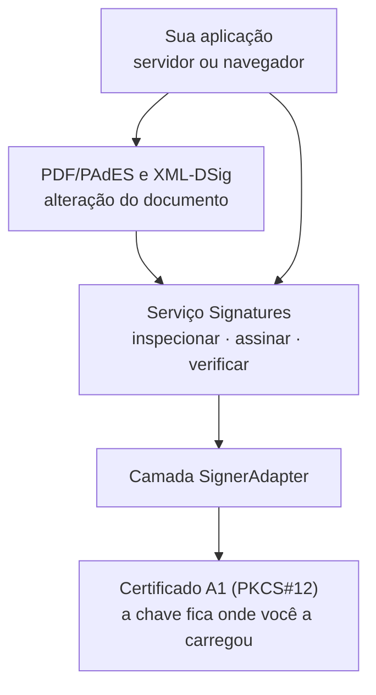

SignatureKit é uma biblioteca da **licitei-oss**, a iniciativa de código aberto mantida pela [Licitei](https://licitei.com.br). O código está em [Licitei/signature-kit](https://github.com/Licitei/signature-kit), sob licença MIT.

O SignatureKit coloca a chave de assinatura atrás de um serviço Effect, o `Signatures`. O primeiro backend é o certificado A1 (PKCS#12), e o mesmo serviço atende Node, navegador, XML-DSig e PDF/PAdES.



## Por onde começar

<Cards>
  <Card title="Primeira assinatura" href="/docs/get-started/quickstart" description="Carregue um A1, leia a identidade do titular, assine bytes e verifique o resultado." />
  <Card title="Certificados A1" href="/docs/signing/certificates" description="PKCS#12, identidade e-CPF / e-CNPJ, validade e erros comuns de certificado." />
  <Card title="A camada de assinatura" href="/docs/signing/signers" description="O contrato SignerAdapter e o serviço Signatures usado pelos formatos e pelo React." />
  <Card title="PDF no navegador" href="/docs/a1-signing/browser-pdf-flow" description="O PDF entra, a interface posiciona a assinatura e o A1 só é carregado quando o usuário assina." />
</Cards>

## O contrato

```ts title="signature-kit.ts"
import { a1SignaturesLayer } from "@signature-kit/a1/signer"
import { signatures } from "@signature-kit/signatures"
import { Effect, Redacted } from "effect"

export const signWithA1 = (content: Uint8Array, pfx: Uint8Array, password: string) =>
  Effect.gen(function* () {
    const identity = yield* signatures.inspect()
    const artifact = yield* signatures.sign({ content, algorithm: "rsa-sha256" })

    return { identity, artifact }
  }).pipe(
    Effect.provide(
      a1SignaturesLayer({
        pfx,
        password: Redacted.make(password),
      }),
    ),
  )
```

O programa não sabe onde a chave está. Um A1 carregado no navegador ou no servidor fornece o mesmo serviço `Signatures`, e os módulos de formato consomem esse serviço.

## Princípios

- **A1 primeiro.** O adapter local é o PKCS#12 (`.pfx` / `.p12`), com a senha em `Redacted`.
- **O PDF no navegador fica no pacote de formato.** `@signature-kit/pdf` cuida dos bytes, do posicionamento e da assinatura do PDF. A interface acompanha esse estado e fornece `a1SignaturesLayer` só no momento da ação.
- **Formatos alteram documentos.** XML-DSig e PDF/PAdES montam o documento em torno de `signatures.sign`. O adapter de assinatura não sabe nada de XML nem de layout de PDF.
- **Falhas são valores.** Erros recuperáveis chegam tipados no canal de erro do Effect (`SignatureKitError`, e `PdfError` ou `XmlError` nos formatos), sem exceções.

## Referência

<Cards>
  <Card title="PDF/PAdES" href="/docs/signing/pdf" description="signPdf, política ICP-Brasil, espaço reservado para o CMS e verifyPdf." />
  <Card title="XML-DSig" href="/docs/signing/xml" description="signXml e verifyXml com a dependência explícita de XmlRuntime." />
  <Card title="Posicionamento por âncora" href="/docs/recipes/anchor-placement" description="Encontre o texto da linha de assinatura e posicione o carimbo sem coordenadas fixas." />
  <Card title="Catálogo de erros" href="/docs/signing/errors" description="Códigos literais e os metadados guardados em cada falha." />
</Cards>

```package-install
@signature-kit/signatures @signature-kit/a1
```

<Callout type="warn" title="Verificação local não é validade jurídica">
  `verifyXml`, `verifyPdf` e `signatures.verify` conferem a assinatura criptográfica. Não decidem se o documento tem
  validade jurídica: valide a cadeia com as suas raízes de confiança e aplique a política ICP-Brasil antes de aceitar
  um documento assinado.
</Callout>
