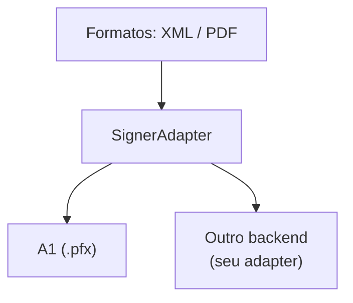

O `SignerAdapter` é o ponto por onde a assinatura local entra. Ele define _onde_ os bytes são assinados (hoje, um `.pfx` A1), enquanto os formatos de documento (XML e PDF) dependem só desse contrato. As APIs de provedores remotos ficam fora dele: veja [Formato da solicitação](/docs/providers/request-shape).



## O contrato SignerAdapter

O tipo exportado por `@signature-kit/signatures`:

```ts title="core/signatures/src/signatures.ts"
export type SignerAdapter = {
  readonly id: string;
  inspect(): Effect.Effect<SignerIdentity, SignatureKitError>;
  certificate(): Effect.Effect<Certificate, SignatureKitError>;
  importSigningKey(algorithm: SignatureAlgorithm): Effect.Effect<CryptoKey, SignatureKitError>;
  sign(input: SignInput): Effect.Effect<SignatureArtifact, SignatureKitError>;
  verify(input: VerifyInput): Effect.Effect<VerificationResult, SignatureKitError>;
};
```

## Membros

- `id`: identifica o backend. O A1 usa `"a1"`.
- `inspect()`: retorna um `SignerIdentity` com `subject`, `issuer`, `serialNumber`, `thumbprint`, `validFrom`, `validTo` e `document?` (CPF ou CNPJ).
- `certificate()`: retorna o `Certificate` completo (`certPem`, `certificateDer`, `publicKeyDer`, `privateKeyPem: Redacted<string>` e os demais campos).
- `importSigningKey(algorithm)`: importa a `CryptoKey` de assinatura para o `SignatureAlgorithm` pedido: `"rsa-sha256"`, `"rsa-sha512"` ou o legado `"rsa-sha1"`, que não é recomendado.
- `sign(input)`: recebe um `SignInput` (`{ content, algorithm }`) e retorna um `SignatureArtifact` (`{ algorithm, signature }`).
- `verify(input)`: recebe um `VerifyInput` (`{ content, signature, algorithm }`) e retorna um `VerificationResult` (`{ valid, algorithm }`).

<Callout type="info">
  Todos os membros falham pelo canal de erro com `SignatureKitError`, nunca com uma exceção. O campo `retryable` é
  definido em cada ponto de falha, não fixado por código.
</Callout>

## Carregue um A1

O pacote `@signature-kit/a1` implementa o contrato a partir de um arquivo `.pfx`/`.p12`. `loadA1SignerAdapter(options)` lê o arquivo e retorna um `SignerAdapter` com `id` `"a1"`.

```package-install
@signature-kit/signatures @signature-kit/a1
```

```ts title="signer-a1.ts"
import { loadA1SignerAdapter } from "@signature-kit/a1/signer"
import { Effect, Redacted } from "effect"

export const program = Effect.gen(function* () {
  // loadA1SignerAdapter -> Effect<SignerAdapter, SignatureKitError>
  const signer = yield* loadA1SignerAdapter({
    pfx,                                   // Uint8Array — bytes do PKCS#12
    password: Redacted.make(process.env.A1_PASSWORD ?? ""),
  })

  signer.id                                        // "a1"
  const identity = yield* signer.inspect()         // SignerIdentity
  return yield* signer.sign({ content, algorithm: "rsa-sha256" })
})
```

<Callout type="warn">
  `A1SignerOptions` tem só duas chaves: `pfx: Uint8Array` e `password: Redacted.Redacted<string>`. Um arquivo vazio
  falha com `signature-kit.EMPTY_FILE`; bytes que não começam como PKCS#12 (`0x30`) falham com
  `signature-kit.INVALID_FORMAT`.
</Callout>

## Forneça como serviço

`Signatures` é um `Context.Service` com a chave `"@signature-kit/signatures/Signatures"`. Você não o implementa: passe um `SignerAdapter` para `signaturesLayer(signer)` e receba um `Layer<Signatures>`. As funções `signatures.inspect`, `certificate`, `importSigningKey`, `sign` e `verify` exigem `Signatures`, e a layer atende esse requisito.

```ts title="provide.ts"
import { signaturesLayer, signatures } from "@signature-kit/signatures"
import { loadA1SignerAdapter } from "@signature-kit/a1/signer"
import { Effect, Redacted } from "effect"

const program = Effect.gen(function* () {
  // Exigem o serviço, mas não sabem qual é o backend.
  const identity = yield* signatures.inspect()
  const artifact = yield* signatures.sign({ content, algorithm: "rsa-sha256" })
  const result = yield* signatures.verify({
    content,
    signature: artifact.signature,
    algorithm: artifact.algorithm,
  })
  return result.valid
})

const run = Effect.gen(function* () {
  const signer = yield* loadA1SignerAdapter({ pfx, password: Redacted.make(pwd) })

  // signaturesLayer(signer) -> Layer<Signatures>
  return yield* program.pipe(Effect.provide(signaturesLayer(signer)))
})

await Effect.runPromise(run)
```

## Atalho para os formatos

`a1SignaturesLayer(options)` faz as duas coisas de uma vez: lê o A1 e retorna um `Layer<Signatures, SignatureKitError>`. `signXml` e `signPdf` exigem `Signatures`, então basta fornecer essa layer com `Effect.provide`.

```package-install
@signature-kit/xml @signature-kit/pdf
```

```ts title="formats.ts"
import { signXml } from "@signature-kit/xml/sign"
import { xmlRuntimeLayer } from "@signature-kit/xml/runtime"
import { signPdf } from "@signature-kit/pdf/sign"
import { pdfCoreFileLayer } from "@signature-kit/pdf-core/file"
import * as NodeServices from "@effect/platform-node/NodeServices"
import { a1SignaturesLayer } from "@signature-kit/a1/signer"
import { Effect, Layer, Redacted } from "effect"

const pdfCoreLayer = pdfCoreFileLayer.pipe(Layer.provide(NodeServices.layer))

// a1SignaturesLayer(options) -> Layer<Signatures, SignatureKitError>
const layer = a1SignaturesLayer({ pfx, password: Redacted.make(pwd) })

export const program = Effect.gen(function* () {
  // Os formatos exigem Signatures; só a layer muda de um backend para outro.
  const signedXml = yield* signXml({ xml, referenceId: "nfe-1" })
    .pipe(Effect.provide(layer), Effect.provide(xmlRuntimeLayer))

  const signedPdf = yield* signPdf({ pdf, policy: "pades-icp-brasil" })
    .pipe(Effect.provide(layer), Effect.provide(pdfCoreLayer))

  return { signedXml, signedPdf }
})

await Effect.runPromise(program)
```

<Callout type="info">
  `verifyXml` e `verifyPdf` não exigem `Signatures`. O `verifyPdf` usa o certificado embutido no CMS do PDF; o
  `verifyXml` exige que você informe a chave ou o certificado confiável.
</Callout>

## Troque o backend

Trocar a origem da chave é trocar o argumento de `signaturesLayer(...)`. O programa de assinatura continua o mesmo.

```ts title="swap-backend.ts"
import { signPdf } from "@signature-kit/pdf/sign"
import { signaturesLayer } from "@signature-kit/signatures"
import type { SignerAdapter } from "@signature-kit/signatures"
import type { PdfCore } from "@signature-kit/pdf-core/pdf-core"
import { Effect, Layer } from "effect"

declare const a1Signer: SignerAdapter     // de loadA1SignerAdapter (id "a1")
declare const otherSigner: SignerAdapter  // qualquer outro adapter que cumpra o contrato

declare const pdfCoreLayer: Layer.Layer<PdfCore>

const job = signPdf({ pdf, policy: "pades-ades" }).pipe(Effect.provide(pdfCoreLayer))

const program = Effect.gen(function* () {
  // O mesmo programa com dois backends; nada muda no PDF.
  const withA1 = yield* job.pipe(Effect.provide(signaturesLayer(a1Signer)))
  const withOther = yield* job.pipe(Effect.provide(signaturesLayer(otherSigner)))

  return { withA1, withOther }
})

await Effect.runPromise(program)
```

## Onde o adapter termina

O `SignerAdapter` decide **de onde** vem a chave e não altera documentos. Ele recebe `content: Uint8Array` e devolve `signature: Uint8Array`, bytes opacos. Embutir a assinatura em um XML ou em um PDF PAdES é tarefa dos módulos de formato (`@signature-kit/xml`, `@signature-kit/pdf`), que recebem o serviço por `Effect.provide` e por isso não dependem do backend.

Com essa divisão, o módulo XML não sabe de onde veio a chave, e o adapter não sabe se os bytes são uma NF-e ou um PDF.

## Erros mais comuns

Toda falha do adapter é um `SignatureKitError`:

<Cards>
  <Card title="signature-kit.WRONG_PASSWORD" href="/docs/signing/errors#error-catalog">A senha do certificado está errada.</Card>
  <Card title="signature-kit.NO_PRIVATE_KEY" href="/docs/signing/errors#error-catalog">O arquivo não contém chave privada, então não há com o que assinar.</Card>
  <Card title="signature-kit.UNSUPPORTED_ALGORITHM" href="/docs/signing/errors#error-catalog">O arquivo PKCS#12 usa um algoritmo de criptografia não suportado. Um `SignatureAlgorithm` fora do catálogo falha como `signature-kit.INVALID_INPUT`.</Card>
  <Card title="signature-kit.KEY_IMPORT_FAILED" href="/docs/signing/errors#error-catalog">Não foi possível importar a CryptoKey em importSigningKey.</Card>
  <Card title="signature-kit.SIGN_FAILED" href="/docs/signing/errors#error-catalog">A operação de assinatura falhou.</Card>
</Cards>
